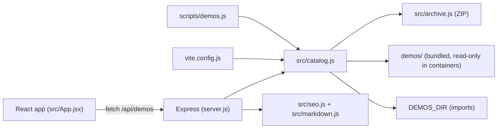

## Overview

The demo catalog is an Express 5 server and a React 19 single-page app built with Vite. Demos are plain folders on disk. The server reads those folders into an in-memory catalog, serves a JSON API and server-rendered HTML, and converts demos to and from ZIP archives. There is no database and no runtime dependency beyond Express and React.



## Repository layout

| Path                     | Purpose                                                                                         |
|--------------------------|-------------------------------------------------------------------------------------------------|
| `demos/<id>/`            | One folder per demo. The folder name is the demo ID.                                            |
| `demos/demo.schema.json` | JSON Schema for `demo.json`. Reference it with `"$schema": "../demo.schema.json"` for editor help. |
| `src/archive.js`         | Dependency-free ZIP writer (`createZip`) and hardened reader (`readZip`).                       |
| `src/catalog.js`         | Manifest validation, catalog loading, export, atomic import, and limits.                        |
| `src/markdown.js`        | Safe Markdown subset parser shared by the browser and the server.                               |
| `src/seo.js`             | Server-rendered HTML for the home page and demo pages, plus the sitemap.                        |
| `src/demos.js`           | Browser helpers: URLs, formatting, search matching, and card artwork selection.                 |
| `src/App.jsx`            | Catalog UI: search, tags, sort, demo page, export links, and the import dialog.                 |
| `server.js`              | Express app factory `createApp` and HTTP routes.                                                |
| `vite.config.js`         | Build plugin that prerenders the home page and every bundled demo page.                         |
| `scripts/demos.js`       | CLI to validate demo folders and pack archives.                                                 |
| `test/`                  | `node:test` suites for the archive, catalog, Markdown parser, and server.                       |

## Demo folder contract

A demo is valid when:

* Its folder name matches `^[a-z0-9]+(?:-[a-z0-9]+)*$` and is at most 64 characters.
* It contains `demo.json` at the top level, and the manifest validates (see below).
* If the manifest contains `id`, it equals the folder name.
* It has at most 200 files, each at most 10 MB, totalling at most 50 MB. These are the same limits as imports, so every valid demo can be exported and re-imported.
* Every file path is relative, uses `/`, has no `.` or `..` segments, and is at most 200 characters and 10 segments deep.

The loader skips `.git/`, `__MACOSX/`, `node_modules/`, `.DS_Store`, `Thumbs.db`, `desktop.ini`, and symbolic links. Other dotfiles, such as `.env.example` or `.dockerignore`, are part of the demo. Folders whose names start with `.` are never treated as demos.

Invalid folders are skipped with a warning in the server log; they never stop the server. Run `npm run demos:check` to see every problem.

## Manifest schema (`demo.json`, version 1)

| Field           | Type     | Required | Rules                                                                                         |
|-----------------|----------|----------|-----------------------------------------------------------------------------------------------|
| `schemaVersion` | integer  | No       | Must be `1`. Missing means `1`.                                                               |
| `id`            | string   | No       | Demo ID; must equal the folder name when present.                                             |
| `title`         | string   | Yes      | 1 to 120 characters after trimming.                                                           |
| `description`   | string   | Yes      | 1 to 500 characters after trimming.                                                           |
| `tags`          | string[] | Yes      | 1 to 10 unique (case-insensitive) tags, 1 to 30 characters each. Used for search and filters. |
| `author`        | string   | No       | 1 to 80 characters.                                                                           |
| `updated`       | string   | No       | Real calendar date, `YYYY-MM-DD`. Defaults to the newest file modification date.              |
| `readme`        | string   | No       | Safe relative path. Defaults to `README.md`. A custom value must point to an existing file.   |

Unknown fields are allowed. The catalog ignores them but keeps them on disk and in exports, so other tools can add metadata without breaking the catalog. When the catalog has to insert `id` (on import or export of a manifest without one), it rewrites `demo.json` as two-space-indented JSON; otherwise the file is kept byte-for-byte.

`validateManifest(value)` in `src/catalog.js` is the single source of truth. Keep `demos/demo.schema.json` in sync when you change it.

## Archive format

An archive is a standard ZIP file:

* `demo.json` sits at the root of the archive, followed by every demo file at its relative path.
* Exports always write `id` into `demo.json`, so an export imports back to the same ID.
* Exports use deflate compression when it saves space, store otherwise, and set the UTF-8 name flag.

Imports accept a little more than exports produce:

* All files can sit inside one top-level folder (for example, when a user zips the folder itself). The folder is stripped.
* Backslash separators are converted to `/`. Names without the UTF-8 flag are read as UTF-8 when valid, otherwise as code page 437.
* Data descriptors (streamed archives) are supported.

The reader rejects encrypted entries, ZIP64, multi-disk archives, compression methods other than store and deflate, duplicate names, CRC mismatches, overlapping or out-of-range entries, and anything that decompresses past the limits. Decompression uses `zlib.inflateRawSync` with `maxOutputLength`, so understated sizes cannot exhaust memory.

### Import ID resolution

The first valid value wins:

1. `id` in `demo.json`.
2. The name of the stripped top-level folder.
3. `slugify(title)`, for example `Hello World!` becomes `hello-world`.

The stored `demo.json` always contains the resolved `id`.

### Limits

All limits live in `LIMITS` in `src/catalog.js`.

| Limit                              | Value  |
|------------------------------------|--------|
| Upload size (`archiveBytes`)       | 25 MB  |
| Files per demo (`files`)           | 200    |
| Size per file (`fileBytes`)        | 10 MB  |
| Size per demo (`demoBytes`)        | 50 MB  |
| Manifest size (`manifestBytes`)    | 64 KB  |
| README returned by the API         | 512 KB |
| Demos in the catalog (`demos`)     | 500    |
| Writable storage (`catalogBytes`)  | 500 MB |

`src/demos.js` mirrors the upload limit as `MAX_IMPORT_BYTES` for the client-side check.

## Storage model

The server reads two directories:

* The bundled directory, always `<app>/demos`. It holds demos committed to the repository.
* The writable directory, `DEMOS_DIR`. Imports are written here.

When both resolve to the same path (the default for local development), the catalog scans it once and every demo is writable, so imports land in the repository's `demos/` folder and can be committed. When they differ (Docker and Kubernetes set `DEMOS_DIR=/app/data/demos`), bundled demos are read-only and win ID conflicts; a writable demo with the same ID is skipped with a warning.

At startup the server creates `DEMOS_DIR` if needed and checks that it is writable. If it is not, imports are disabled (`canImport: false`) and the import button is hidden.

### Atomic imports

Imports are serialized in the server. Each import:

1. Validates the archive completely in memory.
2. Writes files into `DEMOS_DIR/.import-<uuid>/`.
3. Renames that folder to `DEMOS_DIR/<id>/`. For a replace, the existing folder is first renamed to `.backup-<id>.<uuid>` and removed only after the new folder is in place; it is restored if the swap fails.

At startup, leftover `.import-*` folders are deleted. A leftover `.backup-<id>.*` folder is restored when `<id>` is missing (for example, after a crash during a replace) and deleted otherwise.

## HTTP API

All JSON errors use the shape `{ "error": "Plain-language message" }`.

| Method and path                         | Response                                                                                         |
|-----------------------------------------|--------------------------------------------------------------------------------------------------|
| `GET /api/demos`                        | `200 { demos: DemoSummary[], requiresKey, canImport }`                                           |
| `GET /api/demos/:id`                    | `200 DemoSummary & { files: [{ path, size }], readme: { path, text, truncated } \| null }`, `404` |
| `GET /api/demos/:id/files/<path>`       | `200` file as a download, `404`                                                                  |
| `GET /api/demos/:id/export`             | `200` `application/zip` named `<id>.zip`, `404`, `503` when two exports are already running      |
| `POST /api/demos/import[?replace=1]`    | `201 DemoSummary`, or `400`, `401`, `403`, `409`, `413`, `415`, `503`, `507`                     |
| `GET /`, `GET /catalog/:id/`            | Server-rendered HTML with metadata and structured data                                           |
| `GET /sitemap.xml`, `GET /robots.txt`   | Discovery files (`sitemap.xml` requires `SITE_URL`)                                              |
| `GET /articles/*`                       | `301` to `/` for links from the former blog                                                      |
| `GET /healthz`                          | `200 { status: "ok" }`                                                                           |

`DemoSummary` is `{ id, title, description, tags, author, updated, readOnly, size, fileCount }`.

Import requests send the raw ZIP bytes as the body with `Content-Type: application/zip` (`application/x-zip-compressed`, `application/x-zip`, and `application/octet-stream` are also accepted). When `PUBLISH_KEY` is set, include it as `X-Publish-Key`. Example:

```sh
curl -X POST --data-binary @my-demo.zip \
  -H 'Content-Type: application/zip' \
  -H "X-Publish-Key: $PUBLISH_KEY" \
  http://localhost:3000/api/demos/import
```

| Status | Meaning                                                                         |
|--------|---------------------------------------------------------------------------------|
| 400    | No file, not a ZIP, invalid manifest, unsafe path, or other archive problem      |
| 401    | Missing or wrong publishing key                                                 |
| 403    | Request came from another origin                                                |
| 409    | ID already exists (without replace), built-in demo, or conflicting folder       |
| 413    | Upload over 25 MB                                                               |
| 415    | Body is not a ZIP content type                                                  |
| 503    | Imports disabled because `DEMOS_DIR` is not writable                            |
| 507    | Demo-count or storage limit reached                                             |

## Security model

* Demo content is never executed or rendered as HTML by the catalog. READMEs pass through `parseMarkdown`, which produces text blocks that React or `escapeHtml` render. Raw HTML in a README is shown as text.
* Resource and export downloads use `Content-Disposition: attachment`, `Content-Type: application/octet-stream` (or `application/zip`), `Content-Security-Policy: sandbox; default-src 'none'`, and `X-Content-Type-Options: nosniff`, so an uploaded `.html` or `.svg` cannot run script on the catalog's origin.
* File downloads only serve paths that appear in the loaded file list, so request paths cannot escape a demo folder.
* Imports enforce the path, size, count, and format rules above before anything is written, write to a temporary folder, and never follow symbolic links.
* Imports require the same origin and, when configured, a `PUBLISH_KEY` compared in constant time. The server refuses to start in production without `PUBLISH_KEY`.
* The key is a single shared secret. Public deployments that accept community demos also need individual accounts, moderation, and rate limiting.

## Command-line tools

```sh
npm run demos:check                         # validate every folder in ./demos (or DEMOS_DIR)
npm run demos:pack -- fetch-retry-helper    # write fetch-retry-helper.zip, identical to the web export
npm run demos:pack -- my-demo out/demo.zip  # choose the output file
```

`demos:check` exits with a non-zero code when any folder is invalid. CI runs it on every build.

## Add a demo by hand

1. Create `demos/<id>/` with a lower-case, hyphenated ID.
2. Add `demo.json` with at least `title`, `description`, and `tags`. Add `"$schema": "../demo.schema.json"` for editor validation.
3. Add a `README.md` with run instructions, plus the demo's files.
4. Run `npm run demos:check`, then restart the server (or rebuild) to see it.
5. Commit the folder.

Files under `demos/` are excluded from `npm run lint` (see `.oxlintrc.json`), so demos can follow their own style and dependencies. Demos are standalone; do not import application code from them.

## Extend the catalog

### Add a manifest field

1. Validate and normalize the field in `validateManifest` in `src/catalog.js`. Keep it optional so existing demos stay valid.
2. Copy it onto the demo object in `readDemo` and, if clients need it, into `summarize`.
3. Document it in `demos/demo.schema.json`, this guide, and the user guide.
4. Use it in `src/App.jsx` or `src/seo.js`, and add tests in `test/catalog.test.js`.

Bump `SCHEMA_VERSION` only for an incompatible change. Unknown fields are already preserved, so additive fields do not need a new version.

### Change search behavior

Search runs in the browser through `matchesQuery` in `src/demos.js`. Tag filtering and the tag cloud live in `src/App.jsx`. To search README text as well, include it in the list response (mind the response size) or add a server-side search endpoint.

### Change card artwork

`artFor(tags)` in `src/demos.js` maps tags to the artwork styles in `src/Art.jsx` through `ART_RULES`. Add a rule, or add a new style in `Art.jsx` and `App.css`.

### Add an API route

Add the route in `createApp` in `server.js` before the `/api` 404 handler. Throw an error with `status` and `expose: true` (for example, `CatalogError` or the local `HttpError`) to return its message as JSON; other errors become a generic 500. Add coverage in `test/server.test.js`, which starts the app on an ephemeral port with an injected HTML `template`, so tests do not need a build.

### Support another archive format

Archive handling is isolated in `src/archive.js`. To add a format, implement a reader that returns `{ path, data }` entries with the same limit options, select it by content type in the import route, and keep `importDemo` unchanged after the read step.

## Testing

```sh
npm test            # node:test suites in test/**/*.test.js
npm run lint        # Oxlint
npm run demos:check # validate bundled demos
npm run build       # Vite build with prerendered demo pages
```

The archive tests build edge-case ZIP files byte by byte, so they run everywhere. Interoperability tests with the system `zip` and `unzip` tools run when those tools are installed and are skipped otherwise.

## Configuration and deployment

| Variable      | Default        | Purpose                                                                                  |
|---------------|----------------|------------------------------------------------------------------------------------------|
| `PORT`        | `3000`         | Listen port.                                                                             |
| `DEMOS_DIR`   | `<app>/demos`  | Writable directory for imported demos. Use persistent storage in production.             |
| `PUBLISH_KEY` | none           | Shared key required to import. Mandatory when `NODE_ENV=production`.                     |
| `SITE_URL`    | none           | Public origin used for canonical URLs and `sitemap.xml`.                                 |

The Docker image copies `demos/` into the image as read-only bundled demos and sets `DEMOS_DIR=/app/data/demos` on the data volume. The Kubernetes manifest keeps a read-only root filesystem, mounts the persistent volume at `/app/data`, and allows 512 MiB of memory because imports and exports are processed in memory (up to 25 MB uploaded and 50 MB expanded per request, with at most two concurrent exports).

The catalog keeps its state on local disk, so run a single replica. Scaling out requires shared storage for `DEMOS_DIR` and a shared lock for imports.
